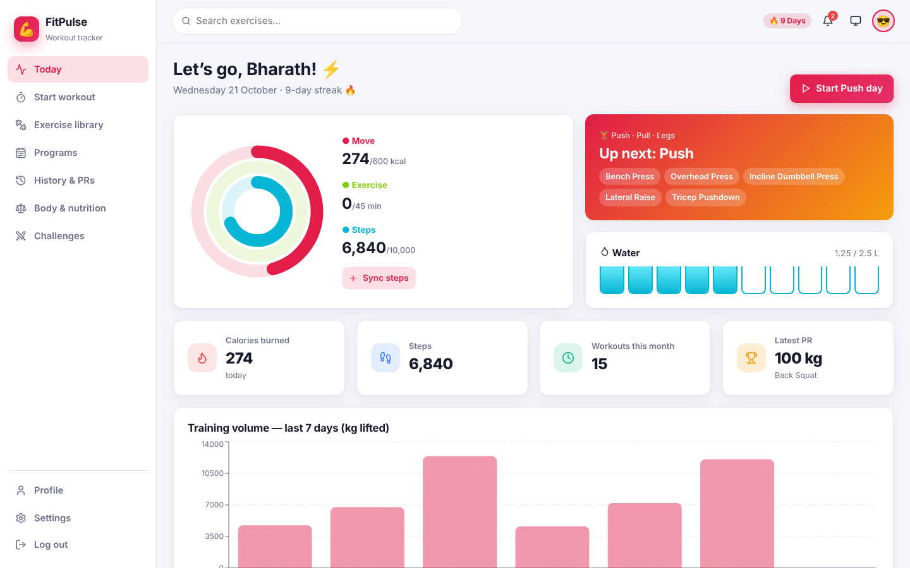
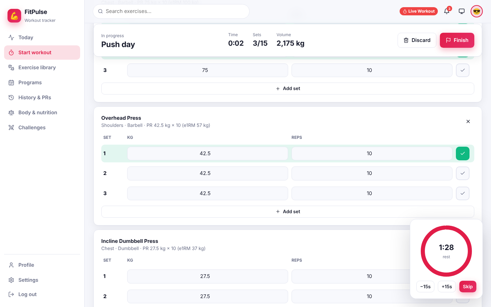
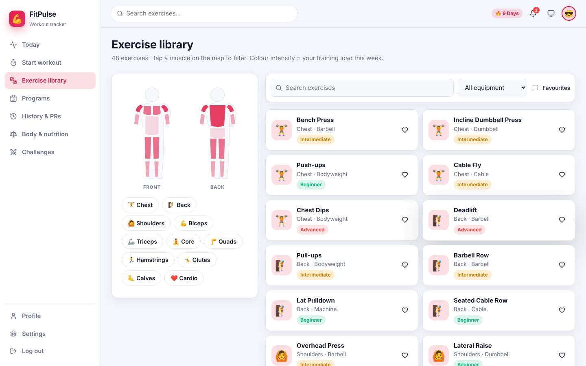
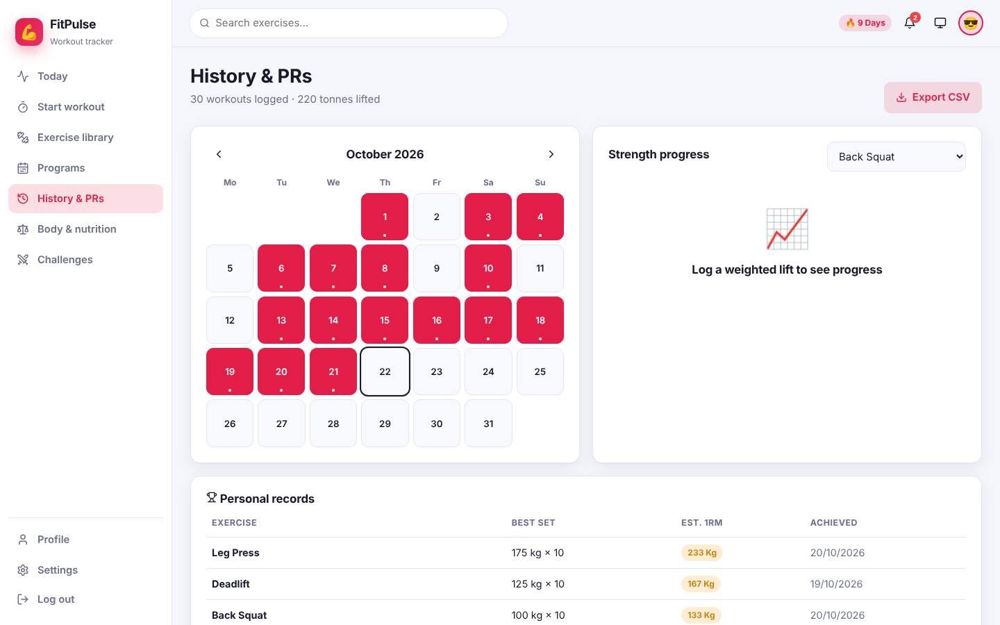
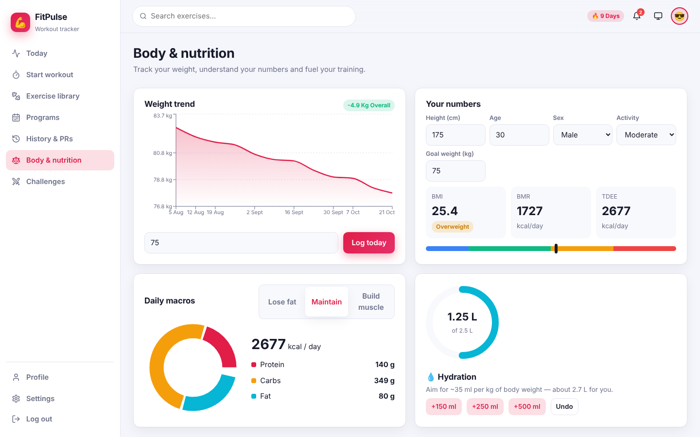
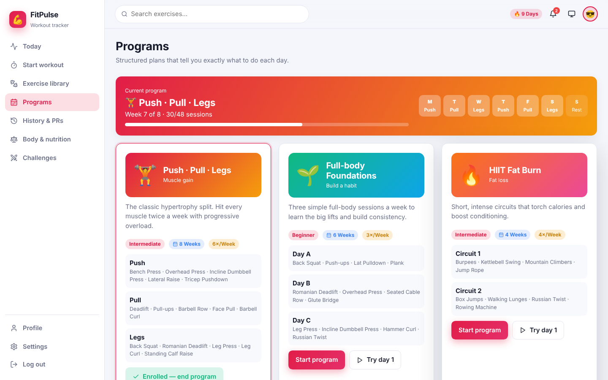

<div align="center">

# 💪 FitPulse

**Smart workout tracker — live sessions with rest timers, automatic PR detection, programs, an interactive muscle map and body & nutrition metrics**


</div>

## ✨ Features

| Area | What you get |
|---|---|
| 🔐 **Auth** | Register & login with salted SHA-256 hashing, password-strength meter, remember-me, demo account, protected routes, profile & password change |
| 📊 **Today** | Animated Move / Exercise / Steps activity rings, “up next” card from your program, tap-to-fill water glasses, streak, latest PR, 7-day training-volume chart |
| ⏱️ **Live workout** | Start from a program day, quick template or custom list · sticky header with elapsed time, sets & volume · editable weight/reps/seconds per set · add/remove sets & exercises · **rest timer** overlay (60–180 s, ±15 s, skip, vibration) · live **PR badges** · finish summary with confetti |
| 🏋️ **Exercise library** | 48 exercises · **interactive front/back SVG muscle map** coloured by this week’s training load · equipment & favourites filters · form cues with animated demo · “train this now” |
| 📅 **Programs** | Push/Pull/Legs, Full-body Foundations, HIIT Fat Burn, Strength 5×5, Core & Mobility · weekly schedule strip, progress through the program |
| 🏆 **History & PRs** | Month calendar of workouts, strength-progress chart (estimated 1RM via Epley + top set), personal-records table, workout details, **CSV export** |
| ⚖️ **Body & nutrition** | Weight trend with goal line, BMI with colour scale, BMR & TDEE (Mifflin-St Jeor), macro split for cut / maintain / bulk, hydration ring |
| ⚔️ **Challenges** | Join step, workout, hydration and plank challenges with live progress, friends’ step leaderboard |
| 🎨 **Themes** | Light / Dark / Midnight / Sepia / System · 6 accents · radius slider · compact & reduce-motion modes |
| 🎞️ **Animations** | Ring fills, water filling glasses, rep-bounce demos, pulsing live badge, calendar pop-ins, growing leaderboard bars, count-up stats, confetti |

## 🖼️ Screenshots

| Today | Live workout |
|---|---|
|  |  |
| **Exercise library** | **History & PRs** |
|  |  |
| **Body & nutrition** | **Programs** |
|  |  |

## 🚀 Getting started

```bash
git clone https://github.com/PreciousBharath/FITPULSE-SMART-WORKOUT-TRACKER.git
cd FITPULSE-SMART-WORKOUT-TRACKER
npm install
npm run dev
```

Log in with **demo@fitpulse.app / Demo@1234** (six weeks of Push/Pull/Legs history, weight log and PRs) — or register and start fresh.

## 🧱 Project structure

```
src/
├── config.js          # Branding, navigation, demo account
├── data.js            # Exercises, muscles, programs, challenges, friends
├── store.jsx          # Sessions, active workout, PRs (Epley 1RM), weight, water, steps, goals (per user)
├── auth.jsx · theme.jsx · toast.jsx · storage.js
├── components/        # Layout, BodyMap (SVG), UI kit (Modal, Ring, Progress, confetti…)
└── pages/             # Today, Session, Exercises, Programs, History, Body, Challenges, Auth, Account
```

## 🛠️ Tech stack

React 18 · React Router 6 · Recharts · Lucide icons · Vite · SVG · CSS variables & keyframes · Web Crypto API · localStorage

> Not medical advice — calorie and macro numbers are estimates.

## 📄 License

MIT © Bharath
